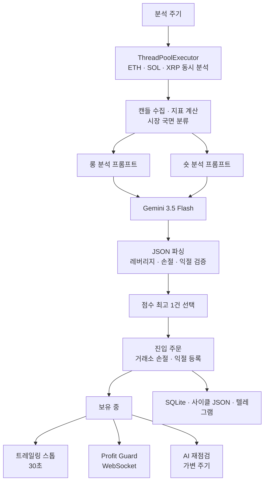

# metis-ai-trader

Bybit USDT 무기한 선물 시장에서 Gemini가 진입과 보유 판단을 내리고, 파이썬 코드가 주문 실행과 안전장치를 맡는 자동매매 봇입니다. 3세대(v3) 아키텍처를 기준으로 정리한 개인 프로젝트 저장소입니다.

AI 기반 판단의 한계를 정리한 뒤, 장기 백테스트와 검증이 가능한 규칙 기반 후속 프로젝트([metis-rule-trader](https://github.com/deltaomega02/metis-rule-trader))로 전환했습니다.

## 세대별 기록

| 버전 | 운영 기간 | 대상 종목 | 모델 | AI 역할 범위 | 운영 방식 |
| --- | --- | --- | --- | --- | --- |
| v1 | 2026-01-31 ~ 2026-03-26 | BTC | Gemini 3.1 Pro | 진입 여부 판단 (손절/익절은 코드가 계산) | GCP VM 실거래 (144건 체결, 재점검 336회) |
| v2 | 2026년 5월 초 | BTC, XRP | Gemini 3.1 Pro | 방향, 레버리지, 손절, 익절, 진입 후 재점검 | 페이퍼 모드 추가, 실거래 9건 후 설정 초기화 및 v3 전환 |
| v3 | 2026-05-12 ~ 2026-05-22 | ETH, SOL, XRP | Gemini 3.5 Flash | 진입 방향/근거 판단, 보유 중 포지션 재점검 | GCP VM 백그라운드(nohup) 실행, 5월 20일부터 페이퍼 모드 |

세대마다 실거래 표본이 적었고 운영 결과는 손실로 마감했습니다. LLM의 추론은 비결정적이라 과거 데이터로 당시 판단을 똑같이 재현해 검증하기 어려웠습니다. 이에 따라 다음 세대에서는 전략의 재현성과 장기 백테스트 검증이 가능한 규칙 기반 엔진으로 옮겨가게 되었습니다.

## 동작 방식



1. **지표 계산 및 국면 분류**: Bybit에서 캔들을 수신해 EMA, RSI, MACD, ADX, ATR, 볼린저 밴드를 계산합니다. 15분봉과 4시간봉 데이터를 조합해 시장 국면(추세, 횡보 등)을 코드로 1차 분류합니다.
2. **병렬 분석**: `ThreadPoolExecutor`를 통해 3개 종목(ETH, SOL, XRP)을 동시에 분석합니다. 종목 안에서도 롱 프롬프트와 숏 프롬프트를 별도 스레드로 호출해 지연을 줄입니다.
3. **응답 파싱 및 유효성 검증**: 모델 응답(JSON)을 파싱하고 레버리지, 손절가, 익절가 수치가 허용 범위 내에 있는지 검증합니다. 비정상적인 값이나 포맷 오류는 걸러냅니다.
4. **단일 후보 선정 및 진입**: 생성된 진입 후보 중 점수가 가장 높은 1건만 선택합니다(동점 시 ETH > SOL > XRP 순). 이긴 후보의 분석 결과를 그대로 사용해 주문을 넣으므로 진입 시점에 API를 다시 부르지 않습니다.
5. **다중 안전장치 가동**: 포지션이 열리면 거래소 기본 조건부 주문 외에도 코드 레벨의 트레일링 스톱, 실시간 WebSocket 가격 모니터링, 주기적인 AI 재점검이 병렬로 돌아갑니다.
6. **기록 및 알림**: 체결 내역과 상태는 SQLite에 남기고, 분석 사이클별 원본 데이터(지표 수치, AI 추론 전문, 최종 결정)는 JSON 파일로 기록하며 텔레그램으로 전송합니다.

## 설계에서 정한 것

**병렬 분석과 단일 진입**

분석 주기가 돌아오면 대상 종목과 방향(롱/숏) 프롬프트를 스레드 풀에서 동시에 처리합니다. 여러 종목에서 진입 신호가 나오더라도 점수가 가장 높은 1건만 골라 진입합니다. 중복 호출 비용을 아끼기 위해 후보 평가 단계의 결과를 진입 주문에 그대로 넘깁니다.

**AI 응답 검증과 폴백**

LLM 응답은 정형화된 JSON으로 받되, 코드 레벨에서 레버리지 배수와 손익절 비율의 상하한을 검사합니다. 포지션 보유 중 수행하는 재점검 단계에서 알 수 없는 액션이 반환되거나 수정 수치가 누락된 경우, 포지션을 건드리지 않고 유지(HOLD)로 넘깁니다. 재점검 주기 값도 허용 범위 안으로 잘라내어 극단적인 딜레이를 막았습니다.

**보유 중 안전장치 분리**

포지션 관리는 단일 로직에 의존하지 않고 역할을 쪼갰습니다.

* **거래소 조건부 주문**: 봇이 멈춰도 거래소가 손절을 지키도록 진입 즉시 하드 손절/익절가를 거래소에 등록합니다.
* **트레일링 스톱**: WebSocket으로 감시하며 가격 기준 수익률 +2%부터 활성화됩니다. 고점(숏은 저점)에서 1.5% 거리를 두고 손절가를 유리한 방향으로만 옮기며 거래소 정정 요청에는 30초 쿨다운을 둡니다.
* **Profit Guard**: WebSocket으로 실시간 가격을 감시하며 급격한 수익 반납이 생길 때 청산합니다.
* **AI 재점검**: 모델이 정한 주기로 모델을 호출해 추세 변화 여부를 보고 유지 혹은 조기 청산을 결정합니다.

**재시작 시 상태 대조**

프로세스가 켜질 때 지갑 잔고를 먼저 확인합니다. 이미 열려 있는 포지션이 있으면 신규 진입을 건너뛰고 재점검 루프로 바로 진입합니다. 데이터베이스에 '열림' 상태로 남아있으나 거래소 실계좌에 포지션이 없다면 강제로 상태를 맞추어 동기화 오류를 방지합니다.

**페이퍼 모드 지원**

`PAPER_MODE=true` 플래그를 두어 동일한 파이프라인으로 동작하도록 했습니다. 실시간 시장 호가로 가상 체결을 계산하고 DB에 상태를 기록하되, API 서명이 필요한 거래소 주문 엔드포인트는 호출하지 않습니다.

## 기술 스택

| 영역 | 사용 기술 |
| --- | --- |
| 언어 및 환경 | Python, GCP Compute Engine |
| 거래소 API | requests (Bybit V5 REST 직접 서명), websocket-client |
| LLM | google-genai (Gemini 3.5 Flash) |
| 데이터 및 분석 | pandas, numpy, matplotlib |
| 스케줄링 및 알림 | threading.Timer, requests (Telegram Bot API) |
| 데이터 저장 | SQLite |

## 프로젝트 구조

| 파일/디렉터리 경로 | 역할 |
| --- | --- |
| `main.py` | 메인 루프 실행, 스케줄러 등록, 병렬 분석 및 진입 후보 선택 |
| `ai/gemini_client.py` | Gemini API 호출, 지연 시 재시도, JSON 파싱 및 응답 검증 |
| `ai/prompts.py` | 진입 평가 및 보유 포지션 재점검 프롬프트 관리 |
| `config/settings.py` | 환경 변수와 거래·모델·재점검 설정 |
| `config/logging_config.py` | 콘솔 및 파일 로깅 포맷 설정 |
| `core/data_fetcher.py` | Bybit 캔들, 기술 지표, 선물 데이터 수집 |
| `core/technical_analysis.py` | EMA, RSI, MACD, ADX, ATR, 볼린저 밴드 계산 |
| `core/regime_engine.py` | 15분봉/4시간봉 데이터 기반 시장 국면 규칙 분류 |
| `core/leverage_calculator.py` | AI가 정한 레버리지·손절·익절의 안전성 검증과 청산가·수량·손익·수수료 계산 |
| `core/position_manager.py` | 포지션 열기·닫기, 청산가 검증, 시장가 주문, 펀딩비 반영 |
| `core/trailing_stop.py` | 30초 주기 트레일링 스톱 추적 및 손절선 상향 이동 |
| `core/websocket_watcher.py` | 실시간 가격 감시, Profit Guard, 손절·익절·청산가 근접 감시 |
| `core/trigger_monitor.py` | 대기 중 5분봉 지표와 가격 변동률을 보다가 조건이 맞으면 AI 재분석을 앞당김(기본 비활성) |
| `core/scheduler.py` | 보유 포지션 AI 재점검과 일일 리포트 스케줄 |
| `core/cycle_logger.py` | 분석 주기별 원본 데이터 및 추론 내용 JSON 저장 |
| `core/execution_cache.py` | Bybit 비공개 WebSocket 체결 스트림을 받아 두는 메모리 캐시(청산 체결 확인용) |
| `core/chart_generator.py` | 텔레그램 알림용 미니 차트 생성 |
| `exchange/bybit_client.py` | Bybit REST API V5 래퍼 |
| `exchange/bybit_websocket.py` | Bybit 실시간 WebSocket 클라이언트 |
| `exchange/paper_executor.py` | 실시간 가격 기반 가상 주문 체결기 |
| `database/` | SQLite 테이블 스키마 정의 및 CRUD 인터페이스 |
| `utils/telegram_bot.py` | 매매 체결 및 시스템 에러 알림 전송 |

## 공개용으로 정리하며 발견한 문제

저장소를 공개하기 위해 백업본을 검토하는 과정에서 구조적 결함과 버그를 확인해 수정했습니다.

* **database 패키지 복원**: 아카이브 압축본에서 `database` 디렉터리가 통째로 누락되어 있었습니다. 동일 계열 엔진을 쓰던 v2 서버 배포본의 DB 접근 코드를 가져와 복원했습니다.
* **트레일링 손절가 DB 호출 인자 수정**: 공개하기 전에 코드를 다시 읽다가 `core/trailing_stop.py`에서 DB 갱신 함수를 잘못된 인자 이름으로 호출하는 것을 찾아 `stop_loss_price`로 맞췄습니다. 같은 검토에서 트레일링 매니저가 시작 시 없는 키를 읽어 시작되지 않는 점도 확인했습니다. 이 시작 오류는 남아 있으며 실제로 동작하는 트레일링은 FuturesWatcher의 2% 활성화·1.5% 추적 로직입니다.
* **불필요한 레거시 파일 정리**: 이전 세대에서 쓰다 남은 구형 레버리지 계산 모듈과 테스트용 수기 데이터 스크립트를 제거했습니다.

## 규칙 기반으로 옮긴 이유

프롬프트 엔지니어링만으로 시스템 매매에 필요한 일관성을 확보하기 어려웠습니다.

* **재현 불가능성**: LLM의 판단은 비결정적입니다. 과거 특정 시점의 캔들 데이터를 다시 넣어도 실거래 당시와 완전히 동일한 응답을 뱉는다는 보장이 없습니다.
* **백테스트의 부재**: 수년 치의 분봉 데이터 위에서 전략의 MDD(최대 낙폭), 승률, 손익비를 수치로 검증할 수 없었습니다. 표본이 몇십, 몇백 건 수준에 머물러 전략의 유의성을 통계적으로 판단하기 어려웠습니다.

이 경험을 바탕으로, 이후 버전에서는 AI를 배제하고 모든 진입·청산 조건을 수학적 수식으로 고정한 규칙 기반 엔진([metis-rule-trader](https://github.com/deltaomega02/metis-rule-trader))을 개발하게 되었습니다.

## 실행 방법

```bash
python3 -m venv venv
source venv/bin/activate
pip install -r requirements.txt

cp .env.example .env   # 키를 채우고 PAPER_MODE=true 로 둡니다
python -u main.py
```

## 한계

* **단위 테스트 부재**: 자동화된 테스트 코드가 없습니다. 런타임 환경에서 동작을 확인해야 합니다.
* **검증 불가**: AI의 판단 특성상 과거 시점 캔들 데이터를 통한 정량적 백테스트가 불가능합니다.
* **프로세스 관리 취약**: systemd 데몬 대신 단순 백그라운드 프로세스(`nohup`)로 구동했기 때문에 프로세스가 예기치 않게 종료되었을 때 자동 복구가 되지 않았습니다.
* **부족한 표본**: 실거래 체결 건수가 적어 통계적으로 유의미한 기대값을 도출하지 못했습니다.

---

본 프로젝트는 시스템 설계 및 파이프라인 검증을 위한 개발 기록물이며, 투자 조언이 아니므로 실제 자금 운용에 사용하지 마십시오.
